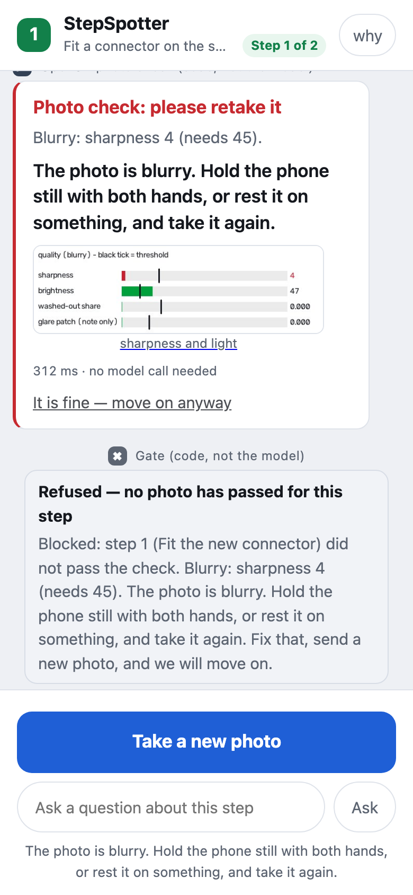
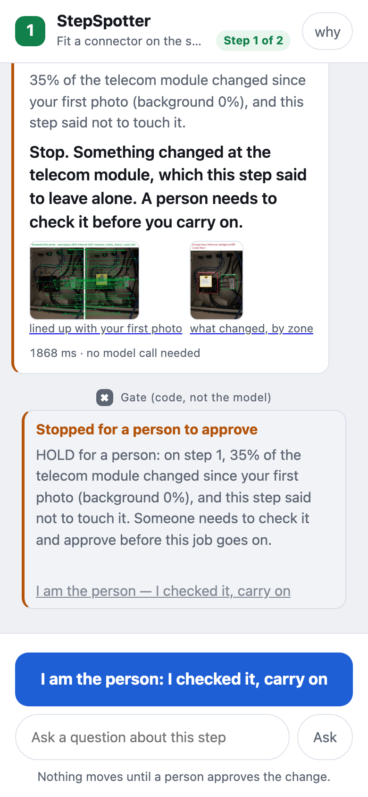
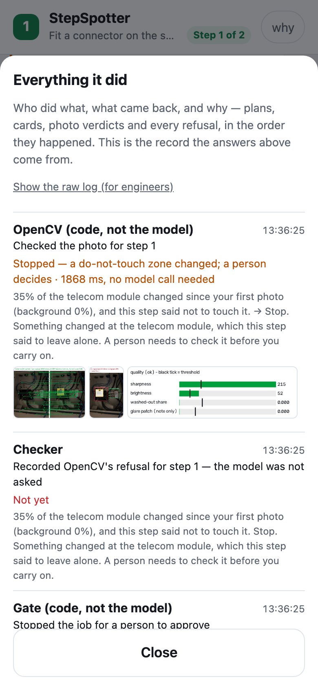
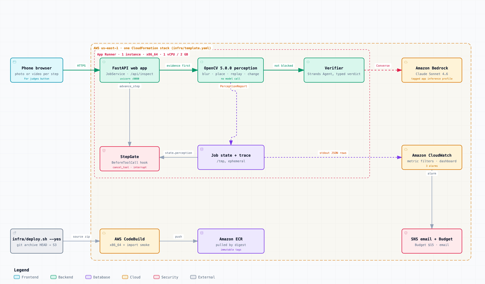
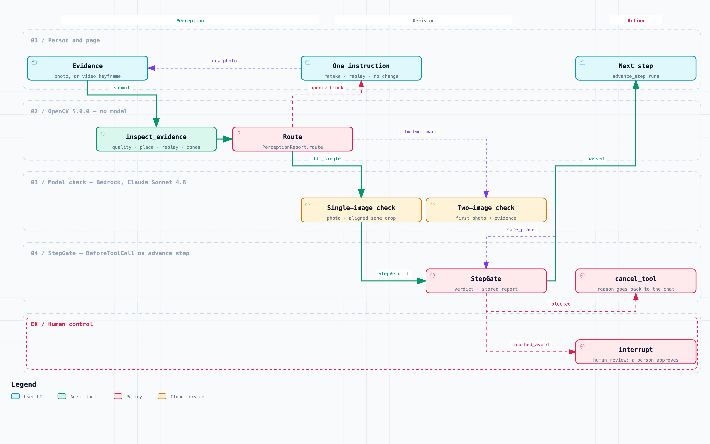

# StepSpotter × OpenCV 5


**A home-repair assistant that will not take your word for it.** You get one step at a
time on a photo of your own thing, and the next step opens only when a photo proves the
last one was done. OpenCV 5 checks every evidence photo **before** any model sees it —
and what it finds changes what the system does next.

Entry to the **OpenCV AI Competition 2026, powered by AWS**. Live on AWS App Runner:
**<https://utgfmpcgxf.us-east-1.awsapprunner.com>** · technical report:
[`docs/REPORT.md`](docs/REPORT.md) (PDF: [`docs/report/StepSpotter-OpenCV26-report.pdf`](docs/report/StepSpotter-OpenCV26-report.pdf))
· video (3:33): <https://youtu.be/i219UI-TS5Y>

> **Demo paused until Oct 26 to save credits; it reopens before judging.** Meanwhile everything in
> [Run it](#run-it) works offline, and the video shows the live app.

## Judge it in two minutes

| claim | proof | what you will see |
|---|---|---|
| OpenCV 5 runs on AWS and decides before any model | live app → **For judges: the OpenCV checks, no model** → *Blurry photo* | decision `retake`, the time in ms, "no model call needed", the gate refusing to move on |
| OpenCV's output changes the next call | [`tests/test_perception_gate.py`](tests/test_perception_gate.py) (offline, the model replaced by a recorder) | one test per decision: no model call, one-photo check, two-photo check, `cancel_tool`, `interrupt` |
| The real agent acts on it | [`data/demo/agentic-opencv/transcript.md`](data/demo/agentic-opencv/transcript.md) (live Bedrock run) | `retake` in 44 ms with no model call; another room goes to the two-photo check and fails; 52 matched points → pass → `advance_step` allowed; a skip attempt cancelled by the gate |
| More bad photos stopped, for less | [`docs/EVAL.md`](docs/EVAL.md) § Headline · [`eval/results/compare.json`](eval/results/compare.json) | 50 test cases: 30 of 33 bad photos refused (the model on one photo: 11); 4 of 17 good ones refused (model: 3); $0.89 per 100 checks (model: $1.27) |
| Ordinary photos still get through | [`eval/results/originals.json`](eval/results/originals.json) | 0 of 56 unmodified real photos refused by OpenCV after the glare fix, which these same photos prompted (8 of 56 before) |
| OpenCV 5.0.0 is what runs in the container | [`infra/buildspec.yml`](infra/buildspec.yml) line 24 · [`pyproject.toml`](pyproject.toml) | the build prints `cv2 5.0.0` from inside the image; `opencv-python-headless==5.0.0.93` pinned |
| One stack, observable and capped | [`infra/template.yaml`](infra/template.yaml) · [`docs/OPERATIONS.md`](docs/OPERATIONS.md) | App Runner, metric filters on the perception trace, 3 alarms, a dashboard, a $15 Budget |
| The 3:33 video | <https://youtu.be/i219UI-TS5Y> | the team, the live app, the architecture and the results |

## In 60 seconds

**What it does.** Name a small job (a network jack, a low-voltage panel, a
pressure-washer assembly) and send a photo. StepSpotter, a Strands Agents app on Amazon
Bedrock, plans the job, draws step 1 on your photo — where to work, what not to touch,
what the next photo must show — and waits. The `advance_step` tool is cancelled in code
by a Strands `BeforeToolCall` hook until a photo passes.

**Why OpenCV changes the decision.** A model looking at one photo cannot tell a blurred
photo from an unfinished step, the panel you started on from a similar one, or a change
in the work zone from a change in the zone you were told not to touch. OpenCV 5 can, without a
model: about 70 ms per photo on a Mac Studio (p50 over 548 cases, `eval/results/opencv.json`) and
0.2–1.9 s on the 1-vCPU App Runner instance (the live screenshots in `docs/screens/`):

| OpenCV sees | what happens next |
|---|---|
| blur, dark, glare, the part out of frame | refused **without a model call**, with one instruction ("hold still", "more light", "step back") |
| the same photo sent again | refused without a model call |
| nothing changed in the work zone | refused without a model call |
| something changed in the do-not-touch zone | the gate stops the run (`interrupt`); in the web app it goes on only after the user presses "I am the person — I checked it, carry on" |
| it cannot line the photo up with your first photo | the model gets **both** photos and must answer `same_place`; the gate needs `true` |
| it all checks out | the model checks the photo, with OpenCV's aligned crop of the work zone |

Policy and every threshold: [`docs/PERCEPTION.md`](docs/PERCEPTION.md).

## For judges

1. Open <https://utgfmpcgxf.us-east-1.awsapprunner.com> (phone or desktop).
2. Press **"For judges: the OpenCV checks, no model"**. Four buttons run real jobs
   through the real gate on photos shipped in the repo; the model is never called:
   - *Blurry photo* → `retake` with one instruction, gate refuses.
   - *Photo OpenCV cannot line up* → `place_unconfirmed`, route `llm_two_image` (stops
     before the model call).
   - *The first photo sent again* → `replay`, gate refuses.
   - *Change in a do-not-touch zone* → `touched_avoid`, the run stops for a person; the
     **"I am the person — I checked it, carry on"** button approves.
3. Press **why** (top right) → **Everything it did**: the row *OpenCV photo check (code,
   not the model)* shows the decision, the time and "no model call needed", with the
   match lines and the change heatmap.
4. For a full job with the model: **Try a demo job**, then *Send the wrong photo* and
   *Send the right photo*.
5. **Agent mode** — <https://utgfmpcgxf.us-east-1.awsapprunner.com/agent>: here the
   Strands Guide agent decides which tools to call. Send a task with a photo
   (`src/stepspotter/web/demo_photos/02-panel-inside.jpg` works), then a blurred photo
   (`data/demo/agentic-opencv/photos/02-panel-inside-blurred-sigma4.jpg`), one of another
   place (`04-office-jack-front.jpg`) and the panel from further back
   (`01-panel-overview.jpg`). Each answer shows the tool calls, OpenCV's decision
   and pictures for the photo, and any gate refusal. A recorded run of exactly that, with
   the full trace, is in [`data/demo/agentic-opencv/`](data/demo/agentic-opencv/transcript.md).

The service is capped per day for everyone together — 6 jobs, 30 photo checks (the four
judge buttons count as photo checks) and 60 agent turns — to keep it inside its budget. If the page says the demo
"has run its … for today", everything below runs offline. Exact steps and expected results:
[`docs/SUBMISSION.md`](docs/SUBMISSION.md) § Testing instructions.

<p>



</p>

Live app, 21 October 2026 (build 3f75518), "For judges" buttons: a blurred photo refused in 312 ms with no
model call; a change in the do-not-touch zone stopped for a person; the trace row with OpenCV's pictures.
More screens, including agent mode and the desktop layout: [`docs/screens/`](docs/screens/).

## Architecture





Interactive versions with every node's source file and line:
[`docs/diagrams/architecture.html`](docs/diagrams/architecture.html),
[`docs/diagrams/agent-workflow.html`](docs/diagrams/agent-workflow.html).

## Results

From [`docs/EVAL.md`](docs/EVAL.md) (548 cases; every number has the command that
reproduces it). The model sample — 50 test-half cases, the same frozen sample for every
configuration:

| | A: model, 1 photo | A′: model, 2 photos | C before the glare fix | **C: OpenCV → model** |
|---|---:|---:|---:|---:|
| bad photos refused (of 33) | 11 | 19 | 31 | **30** |
| good photos wrongly refused (of 17) | 3 | 3 | 8 | **4** |
| … without the 2 mislabelled same-place pairs (of 15) | 2 | 1 | 6 | **2** |
| model calls for 54 checks | 54 | 54 | 24 | 31 |
| time p50 / p95 | 2 989 / 3 738 ms | 3 689 / 5 027 ms | 95 / 5 159 ms | 2 920 / 4 556 ms |
| $ per 100 checks | 1.27 | 1.80 | 0.71 | 0.89 |

- On real look-alikes of another place, A′ (the model shown both photos) is as good as C.
  C's edge is what a model cannot see in one or two photos: a photo sent again, nothing
  changed in the work zone, a change in a do-not-touch zone, overexposure, a work zone cut
  off.
- OpenCV alone on all 548 cases: 0 of 56 unmodified real photos refused after the glare fix,
  which these same photos prompted (8 of 56 before); 2 of 66 good test-half photos wrongly
  refused; p50 / p95 68 / 111 ms on the test half, on a Mac Studio.
- Still open: mirror-image look-alikes pass every configuration; a resent photo with a circle
  drawn on it passes; one smeared video frame passes the blur check.
- The model numbers rest on 2 cases per synthetic class, one run each — examples, not rates.

Failures, with pictures: `docs/EVAL.md`, `eval/results/figures/`.

## Run it

Python 3.12. Pinned: `opencv-python-headless==5.0.0.93`, `numpy==2.5.4`,
`strands-agents==1.55.0` (`pyproject.toml`); every other version the tests passed with is in
`constraints.txt`. The cloud build runs `import cv2` inside the
built image and prints its version (`infra/buildspec.yml`).

```bash
git clone https://github.com/retailbox-automation/stepspotter-opencv && cd stepspotter-opencv
python3.12 -m venv .venv && .venv/bin/pip install -c constraints.txt -e ".[dev]"
tools/fetch_models.sh                                    # YuNet face detector, SHA256-checked

# test — offline, no AWS account
.venv/bin/python -m pytest -q -m "not integration"       # fresh clone: 438 passed, 7 skipped *

# eval — OpenCV only, no AWS account
.venv/bin/python eval/build_set.py && .venv/bin/python eval/run.py --config opencv

# run the app (the model steps need Bedrock access to Claude Sonnet 4.6 in us-east-1)
.venv/bin/stepspotter serve --port 8137

# deploy to AWS — one CloudFormation stack; creates billable resources
BUDGET_EMAIL=you@example.com ALERT_EMAIL=you@example.com infra/deploy.sh --yes
infra/destroy.sh --yes                                   # removes it
```

\* Six card-rendering tests need the author's raw panel photos, which are not in the repository,
so they skip on a fresh clone (on the author's machine: 444 passed, 1 skipped).

Deploy details, measured durations and cost: [`docs/DEPLOY.md`](docs/DEPLOY.md).
Operations, spend caps, kill switch, logs and privacy: [`docs/OPERATIONS.md`](docs/OPERATIONS.md).

## Where OpenCV changes the decision in code

| what | where |
|---|---|
| OpenCV runs first; a blocked photo never reaches the model | `src/stepspotter/guide.py:409`, `:430` |
| the route picks the one-photo or the two-photo model check | `src/stepspotter/perception/models.py:167`, `src/stepspotter/guide.py:447` |
| fail closed without `same_place=true` | `src/stepspotter/guide.py:453`, `src/stepspotter/gate.py:153` |
| the gate cancels `advance_step` on a blocking report | `src/stepspotter/gate.py:141`, `:118` |
| a change in a do-not-touch zone → `interrupt("human_review")` | `src/stepspotter/gate.py:91` |
| the agent's own OpenCV tool (`inspect_photo`) | `src/stepspotter/guide.py:667` |
| the OpenCV 5 checks | `src/stepspotter/perception/` (quality, scene, change, frames, privacy) |

## Documents

[`docs/REPORT.md`](docs/REPORT.md) technical report ·
[`docs/PERCEPTION.md`](docs/PERCEPTION.md) the OpenCV layer ·
[`docs/EVAL.md`](docs/EVAL.md) evaluation ·
[`docs/DEPLOY.md`](docs/DEPLOY.md) / [`docs/OPERATIONS.md`](docs/OPERATIONS.md) AWS ·
[`docs/PLATFORM-FINDINGS.md`](docs/PLATFORM-FINDINGS.md) what we learned about OpenCV 5,
AWS and Strands ·
[`docs/AI-USE.md`](docs/AI-USE.md) how AI was used ·
[`docs/SUBMISSION.md`](docs/SUBMISSION.md) the Devpost texts ·
[`docs/ARCHITECTURE.md`](docs/ARCHITECTURE.md) the agent roles from the first build.

## Safety

For low-voltage, low-consequence work only. The planner refuses mains wiring, gas,
roofing and structural work with an empty step list (`src/stepspotter/planner.py:26`).
That refusal is a model judgement, not a certified hazard classifier.

## Disclosure

StepSpotter was built on 9–14 September 2026 for the AWS "Agents for Humans" hackathon
(Devpost) and was also submitted to the AI Builders hackathon (judging not finished). That code is
public at <https://github.com/retailbox-automation/stepspotter> (commit `80979af`) and is
imported here as the first commit, `295e3f3`, with the text copied from manufacturers'
manuals removed. Everything OpenCV 5 — the perception package, the gate and verifier
integration, face blurring, the evaluation harness, the AWS stack and the documents — was
built on 21–24 October 2026 in this competition's window: commits `9cc6ca1` through
`8831099` (the deployed code; the commits after it change only documentation and add `constraints.txt`). The Official Rules have no clause on previously submitted projects;
the nearest is «From August 26 through October 26, teams will build, evaluate, document,
and submit their final projects.» AI coding assistants were used; see
[`docs/AI-USE.md`](docs/AI-USE.md).

## Licence

Code: MIT ([`LICENSE`](LICENSE)). The MIT licence covers this repository's own code and
our own photos only. Third-party files keep their own terms: the public-domain face test
photo ([`tests/fixtures/ATTRIBUTION.md`](tests/fixtures/ATTRIBUTION.md)), the public
photos used in the evaluation ([`eval/cases/public/ATTRIBUTION.md`](eval/cases/public/ATTRIBUTION.md)),
and the YuNet face detector (MIT, opencv_zoo), which is downloaded at build time and not
committed.
