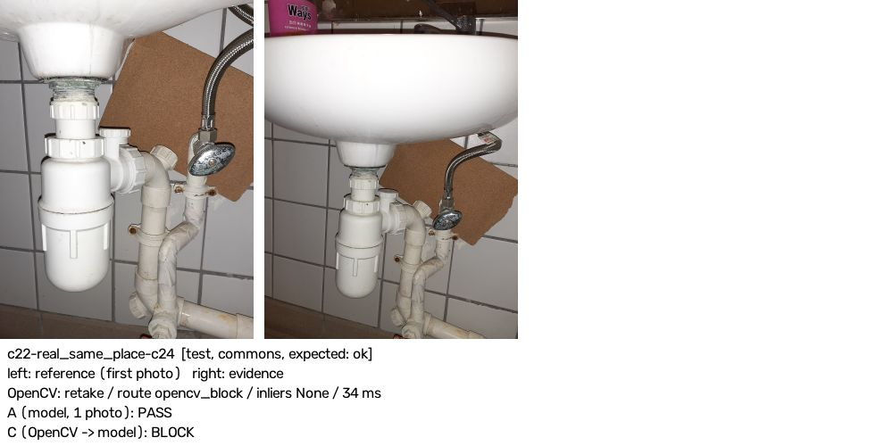
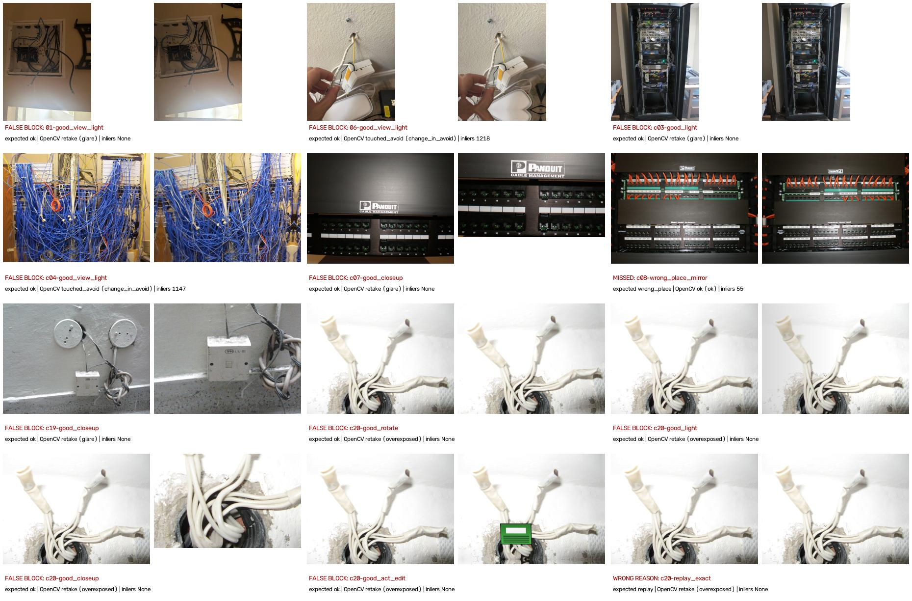

# Evaluation: does OpenCV 5 change what the photo gate decides?

StepSpotter opens the next step of a repair only after a photo proves the last step was
done. This page measures that gate in four configurations on the same cases, with the
same step text and the same verifier code:

| config | what decides | model calls per photo |
|---|---|---|
| **A** — model, one photo | `verify_step(step, evidence)`: Claude Sonnet 4.6 on Bedrock looks at the evidence photo alone (the gate before OpenCV) | 1 |
| **A′** — model, two photos | `verify_step(..., reference_photo=first_photo)`: the model gets the person's first photo AND the evidence for every case and must answer `same_place`; fails closed like the gate | 1 (bigger) |
| **B** — OpenCV 5 only | `inspect_full`: quality, scene match, replay, change in zones. No model | 0 |
| **C** — the shipped gate | OpenCV first. A block ends there (`opencv_block`). A photo OpenCV cannot line up goes to the two-photo check (`llm_two_image`, must answer `same_place`). Everything else goes to the one-photo check with OpenCV's aligned crop of the work zone (`llm_single`) | 0 or 1 |

**Short answer, with its limits.** On the 50 held-out (test-half) cases sent to the model,
C refused 31 of 33 bad photos against 11 of 33 for A and 19 of 33 for A′, made 24 model
calls for 54 checks instead of 54, and cost $0.71 per 100 checks against $1.27 (A) and
$1.80 (A′). It also wrongly refused **8 of 17 good photos against 3 of 17** for A and A′:
4 of the 8 are OpenCV's glare rule firing on bright subjects (a white basin twice, a rack, a
close-up), 4 are model refusals after OpenCV let the photo through (2 of those 4 have a
questionable label, see the label audit). Where C beat A
on a real look-alike of another place, **A′ caught it just as well** (6/6). C's lead over A′
is on what a model cannot see in one or two photos: an earlier photo sent again, nothing
changed in the work zone, a change in a do-not-touch zone, over-exposure and a work zone
cut off. Most of the bad photos are synthetic damage built to match those checks, so near-100 %
catch rates by OpenCV on them are expected by construction. The model figures come from 2
cases per synthetic class and 1–6 per real class, one run each.

## Code and run record

- Code under test: `src/` at main `43c1520` (L1b: `place_unconfirmed` → two-photo check,
  `MIN_INLIERS` 25, YuNet face blurring on). Eval harness: branch `eval2`. Every
  `eval/results/*.json` records `eval_worktree_head`, `main_head` and `l1_checkout_head`.
  The `main` branch moved to `c7c84e0` and later during the model runs. It only added
  docs and tools; `src/stepspotter/perception`, `verifier.py`, `vision.py` and `models.py`
  are unchanged between `43c1520` and `c867804` (`git diff --stat 43c1520 c867804 -- src/stepspotter/perception src/stepspotter/verifier.py`).
- The B run (`opencv.json`, 12:25:07Z) was made with the harness exactly as committed in `082fabd`
  a minute later, so its `eval_worktree_head` field reads the parent, `43c1520`.
- Model: `global.anthropic.claude-sonnet-4-6` (Strands default, `STEPSPOTTER_MODEL` unset), us-east-1.
- Model runs: A 2026-10-21T12:28:19Z, A′ 12:31:56Z, C 12:33:41Z (UTC, from the result files).
  The runs used eval `082fabd` plus a stop-after-3-errors guard, which was committed afterwards and never triggered (0 errors).
- OpenCV 5.0.0, numpy 2.5.4, YuNet installed (`faces_checked: true` in B and C rows).
  Timings come from a shared Mac Studio under other load (`nice -n 15`). They are not App Runner timings.

## The case set (548 cases)

```
python eval/build_set.py          # 548 cases, deterministic (seeds from sha256), ~7 s
python eval/check_commons.py --download   # licence + bytes of every Commons file vs Commons
```

| source | files | how they are used | rights |
|---|---:|---|---|
| OnQ (our house) | 6 photos | the original 99 cases (15 synthetic classes × 6 + 9 real pairs) + 3 new synthetic classes × 6 | Mikhail's own, public since 09.09 |
| Wikimedia Commons | 40 photos, 1280 px thumbnails, byte-identical to Commons | about half of 18 synthetic classes per photo (chosen by hash), 12 real same-place pairs, real look-alikes | CC0 / PD / CC BY / CC BY-SA, read from the Commons API (`extmetadata`), per file in `eval/cases/public/ATTRIBUTION.md`; derivatives of CC BY-SA files are CC BY-SA (`LICENSE-NOTE.md`) |
| Mikhail's own under-sink video (`IMG_2046.MOV`, 20.10) | 16 frames + a 5 s clip, decoded by OpenCV, no metadata | real same-place pairs, real blur, same-cabinet wrong place, keyframe path | his consent 2026-10-21T11:38:30Z; the .MOV (GPS in metadata) is not in the repo (`eval/extract_video.py`) |

Groups and split: one **group** per scene or per object photographed several times (for
example the three Commons shots of one Swedish telephone socket form one group). A group's
half is `calibration` if `sha256('stepspotter-eval-split:'+group)[0] < 128`, otherwise
`test`. The rule was fixed before any result. The OnQ scenes keep their split
(panel = calibration, office jack + dining node = test). No case mixes the halves (enforced
in `build_set.py`). The hash put the own-video group in **calibration**, so every real-blur
and same-cabinet case is calibration-half. They are reported separately below and marked.
**L2 tuned no threshold.** Every threshold is L1's, and all of them were set on the six OnQ
photos before the Commons and video files existed, so both halves of the new data are unseen
by tuning.

Labels: every Commons and video zone and step was placed by hand on a 10 % grid by
this lane (`sources.json`). Video frames were labelled by eye as good / blurred /
borderline. The 2 borderline frames are run but never scored.

| class | kind | OnQ | Commons | own video | of which test half | built how |
|---|---|---:|---:|---:|---:|---|
| good_rotate / reshot / light / closeup / act_edit | good | 6 each | 17–23 each | — | 9–12 each | synthetic (L1 generators) |
| good_view_light | good | 6 | 18 | — | 12 | synthetic: rotate 10°, zoom 1.15, perspective 0.10, side lamp, gamma |
| blur_gaussian, blur_motion, dark, overexposed, glare, zone_cut | bad | 6 each | 16–26 each | — | 8–16 each | synthetic |
| wrong_place_mirror | bad | 6 | 18 | — | 13 | synthetic: mirror twin + perspective |
| replay_exact (same file as the first photo) | bad | 6 | 19 | — | 11 | identical bytes |
| replay_reference (re-encoded + resized) / replay_earlier (re-shot resent, resized, rotated) | bad | 6 each | 18 each | — | 11 / 12 | synthetic |
| no_change / touched_avoid | bad | 6 each | 21 / 16 | — | 14 / 13 | synthetic |
| real_same_place | good | 5 | 12 | 7 | 5 | **real**: two shots of one object |
| real_wrong_place (other rooms of our house) | bad | 4 | — | — | 4 | **real** |
| real_lookalike (a real photo of the same kind of thing, not this one) | bad | 8 | 42 | 2 | 20 | **real** |
| real_replay_annotated (the same capture with a circle drawn on it) | bad | — | 1 | — | 1 | **real** |
| real_blur / real_wrong_place_same_room / real_borderline | bad / bad / unscored | — | — | 4 / 3 / 2 | 0 | **real**, own video |

Totals: 548 cases, 90 real and 458 synthetic; test half 240, calibration 308
(`eval/cases/manifest.json` → `counts`).

**Label audit (found after the runs, not changed):** the real same-place pairs carry the
*first* photo's step. In two of them the second shot cannot show that step: OnQ
04→05 (step "jack seated flush in the plate", but in 05 the jack is pulled out of the
box) and Commons c09→c10 (step "patch panel ports visible", but c10 is a side view of the
rack). The model refused both in A′ and C, with reasons that are right about the photo
("the keystone jack is not snapped into the wall plate"; "the patch panel port faces … are not
visible"). They are still scored as false blocks below. Without them C has 6 false
blocks out of 15, A′ 1/15 and A 2/15.

## Results 1 — the three configurations on the model sample

```
python eval/run.py --make-sample                                    # eval/llm_sample.json, 54 ids, hash per class
python eval/run.py --config llm      --sample --max-llm-calls 54    # A   (spend)
python eval/run.py --config llm2     --sample --max-llm-calls 54    # A'  (spend)
python eval/run.py --config combined --sample --max-llm-calls 42    # C   (spend; made 24)
python eval/compare.py                                              # tables, $, figures — no calls
```

The sample was drawn from the manifest alone and committed (`082fabd`) **before** any model
call. It has 50 test-half cases (every real class at up to 6, 2 Commons cases per synthetic
class) plus 4 own-video cases from the calibration half. Full table:
`eval/results/compare.md`. Per-case answers with the model's own words:
`eval/results/{llm,llm2,combined}-sample.md`.

| class (sample) | kind | n | A | A′ | B | C |
|---|---|---:|---|---|---|---|
| real_lookalike | bad | 6 | 2/6 caught | **6/6** | 1/6 (5 routed) | **6/6** |
| real_wrong_place (other room) | bad | 2 | 2/2 | 2/2 | 0/2 (2 routed) | 2/2 |
| real_replay_annotated | bad | 1 | 0/1 | 0/1 | 1/1 | 1/1 (via glare, see below) |
| real_same_place | good | 5 | 1 false block | 2 | 2 (2 routed) | **4** |
| replay_exact / replay_reference / replay_earlier | bad | 2+2+2 | 0/6 | 3/6 | 6/6 | 6/6 |
| no_change | bad | 2 | 0/2 | 0/2 | 2/2 | 2/2 |
| touched_avoid | bad | 2 | 0/2 | 0/2 | 2/2 | 2/2 (a person is asked) |
| overexposed / zone_cut | bad | 2+2 | 1/4 | 1/4 | 4/4 | 4/4 |
| dark / glare / blur_gaussian / blur_motion | bad | 2+2+2+2 | 6/8 | 7/8 | 8/8 | 8/8 |
| wrong_place_mirror | bad | 2 | 0/2 | 0/2 | 0/2 (1 routed) | **0/2** |
| six good synthetic classes | good | 12 | 2 false blocks | 1 | 2 | 4 |
| own video: real_blur | bad | 2 | 2/2 | 2/2 | 2/2 | 2/2 |
| own video: real_wrong_place_same_room | bad | 2 | 2/2 | 2/2 | 0/2 (2 routed) | 2/2 |

"Routed" means OpenCV could not line the photo up with the first photo and, since L1b,
neither blocks it nor passes it: it goes to the two-photo model check. It is never counted
as caught or missed for B.

| slice | caught / bad: A | A′ | B | C | false blocks / good: A | A′ | B | C |
|---|---|---|---|---|---|---|---|---|
| **test half (50)** | 11/33 | 19/33 | 24/33 | **31/33** | 3/17 | 3/17 | 4/17 | **8/17** |
| test half, real photos only (14) | 4/9 | 8/9 | 2/9 | 9/9 | 1/5 | 2/5 | 2/5 | 4/5 |
| test half, synthetic only (36) | 7/24 | 11/24 | 22/24 | 22/24 | 2/12 | 1/12 | 2/12 | 4/12 |
| own video, calibration half (4) | 4/4 | 4/4 | 2/4 | 4/4 | — | — | — | — |

B's real-photo column leaves out 7 bad and 2 good real photos that it routed to the model.

Who caught C's 35 bad photos on the whole sample: OpenCV for the reason the case was built
for **19**, the model **9**, OpenCV for **another** reason **7** (right outcome, wrong
reason: mostly the glare rule on the white Hong Kong basin, `eval/results/compare.json` → `c_caught_by`).

**Calls, latency, money** (54 checks each; Bedrock price from the AWS Price List API,
`AmazonBedrockFoundationModels`, us-east-1, Claude Sonnet 4.6 global on-demand: $3.00 per
million input tokens, $15.00 per million output tokens, published 2026-10-12, retrieved
2026-10-21 — `eval/results/bedrock-price-sonnet-4-6.json`; the human page is
https://aws.amazon.com/bedrock/pricing/, not read for this. The $ figures are computed
from the token counts Bedrock returned; they are not billed amounts):

| config | model calls | calls avoided | two-photo calls | p50 ms | p95 ms | $ (54 checks) | $ / 100 checks |
|---|---:|---:|---:|---:|---:|---:|---:|
| A | 54 | 0 | 0 | 2 989 | 3 738 | 0.688 | 1.27 |
| A′ | 54 | 0 | 54 | 3 689 | 5 027 | 0.974 | 1.80 |
| B | 0 | 54 | 0 | 60 | 154 | 0 | 0 |
| C | 24 | 30 | 12 | 95 | 5 159 | 0.383 | 0.71 |

C's median is OpenCV's time because more than half of its checks never reach the model.
Its p95 is a two-photo call. Per call: one photo $0.0129 (66 calls, mean 3 239 input tokens),
two photos $0.0181 (66 calls, mean 4 798 input tokens).

**Spent on this evaluation: 132 model calls (A 54 + A′ 54 + C 24) of the 150 cap, $2.04 by
token count.**

### Where C decided differently from A (25 cases) — the trace that OpenCV changes a later decision

Every case with its image pair, OpenCV's numbers and both answers is in
`eval/results/compare.md` (figures under `eval/results/figures/c-vs-a-*.jpg`). C was right
in 20 and wrong in 5. Of the 20, OpenCV decided 13 for the reason the case was built for or
by routing to the two-photo check, and 7 for another reason (glare or blur). A′ agreed with
C in 9 of the 25.

| case | A (one photo) | C | what OpenCV saw |
|---|---|---|---|
| c03-real_lookalike-c05 (test) | passed: "multiple patch panel rows fully populated" | refused by the two-photo check: "a completely different cabinet" | 10 inliers → `place_unconfirmed` → `llm_two_image` |
| c22-real_lookalike-c31 (test) | passed: "the drain trap is clearly visible" | refused: "a corroded metal P-trap on a bright yellow wall — a completely different location" | 5 inliers → two-photo |
| c09-touched_avoid, c10-touched_avoid (test) | passed | `touched_avoid` → the gate asks a person, no model call | change in the do-not-touch zone above the noise floor |
| c27-replay_exact, c03-replay_reference (test) | passed: "water is clearly running" | `replay`, no model call | homography ≈ identity, nothing changed (1335 / 1651 inliers) |
| c05-no_change (test) | passed | `no_change` | the work zone did not change |
| c22-real_same_place-c24 (test) | passed (right) | **refused: glare** (wrong) | white porcelain read as a glare blob |




### A′ against C

- **A′ catches as much as C on places.** On real look-alikes (6/6), on rooms of our house (2/2)
  and on the same-cabinet frames (2/2), the two-photo model is as good as C. In C those cases
  reach the same two-photo check anyway. OpenCV's contribution there is to send them to it
  and to save the call when it does line the photos up.
- **A′ misses what is not visible in two photos:** 0/2 no_change, 0/2 touched_avoid, 3/6
  replays, 1/4 overexposed and zone-cut cases. C catches all of these without a model call.
- **A′ costs 2.5× C per check and is slower at the median** (3.7 s against 0.1 s), and it
  wrongly refused fewer good photos (3/17 against 8/17).

## Results 2 — OpenCV alone on all 548 cases (B)

```
STEPSPOTTER_MODELS=<dir with face_detection_yunet_2023mar.onnx> python eval/run.py --config opencv   # no network
python eval/failures.py          # pictures of every failure
```

`eval/results/opencv.md` (2026-10-21T12:25:07Z), test half / calibration half:

| | test (240) | calibration (308) |
|---|---|---|
| bad photos blocked | 140 of 141 (+33 routed) | 153 of 153 (+50 routed) |
| good photos wrongly blocked | 10 of 66 | 20 of 103 |
| OpenCV time p50 / p95 | 57 / 103 ms | 62 / 109 ms |
| routes | 150 block, 57 one-photo, 33 two-photo | 174 block, 84 one-photo, 50 two-photo |

Test half by class: blur 27 of 28 blocked (1 motion-blur case routed to the two-photo check),
dark 8/8, overexposed 10/10, glare 11/11, zone cut 16/16; all 61 replay, no-change and
touched-avoid cases blocked, 13 of them for another reason than the one built. Good synthetic classes falsely blocked 8 of 63. Real look-alikes 3 of 20 blocked
and 17 routed to the two-photo check, none passed. The mirror twin was blocked 3 of 13,
routed 9 and **passed once** (c08: 55 inliers, a symmetric panel lines up with its mirror image).

**Before/after L1b on the original 99 OnQ cases** (thresholds changed by L1, not here):
before (`ff97511`, docs/PERCEPTION.md run 2) 64/64 bad caught and 3/35 good wrongly blocked
(the three real same-place re-shots refused as `wrong_place`). After (this run) 60 caught,
0 good wrongly blocked, and 7 routed to the two-photo check: the 3 same-place re-shots and the 4
different-room pairs, which are no longer refused by OpenCV.

### Unmodified real photos through the quality check

```
python eval/originals.py         # eval/results/originals.md
```

| photos | n | refused by OpenCV |
|---|---:|---|
| OnQ originals | 6 | 0 |
| Commons originals | 40 | **7** (6 glare, 1 overexposed) |
| own video, good frames | 10 | 1 (glare: the flashlight on the white cabinet wall) |
| own video, blurred by eye | 4 | 3 refused, but only 1 for blur (others: overexposed, glare); **1 passed** (f0195, sharpness p90 above the floor) |

So **8 of 56 ordinary real photos (14 %) are refused before any model sees them**, almost all
by the glare rule (largest saturated blob ≥ 0.5 % of the frame): the white porcelain basins
(HK sink c22–c24, Kohler sink c34–c35), a white wall (c20), c40 (a downspout guard on a
bright pavement) and a flashlight hot spot. This is the largest real weakness found. With the stuck rule a person is not
trapped (the 4th refusal goes to the model), but three wasted retakes is a bad experience.

### Every OpenCV failure, with pictures

`eval/results/figures/opencv-failures-01..06.jpg`, listed in `eval/results/opencv-failures.json`:
30 good photos wrongly blocked, 1 bad photo passed, 34 bad photos blocked for a reason other than the
one they were built for.



1. **Glare on white surfaces** (above): 22 of the 30 false blocks have reason `glare` (4 more
   `overexposed`), and 26 of the 34 wrong-reason catches are `glare` on the same photos. On real white-basin and white-wall
   photos the glare rule fires on the subject itself.
2. **Real blur not seen as blur:** own-video f0195 (a smeared trap) passes the sharpness rule and is
   routed to the two-photo check (16 inliers); it was not in the model sample, so whether the model
   refuses it was not measured.
3. **A real re-shot of the same place is not confirmed:** 10 of 24 real same-place pairs
   are routed to the two-photo check (4–34 inliers). This is the designed fallback, not a block, but
   each costs a two-photo call (+48 % input tokens, +40 % $ per call). c36→c37 (the same downspout box, landscape then portrait)
   is refused as `blurry_vs_reference` at 44 inliers.
4. **Mirror twin:** a symmetric scene lines up with its mirror image (c08). The model also
   accepted both mirror cases in A, A′ and C ("the same downspout outlet"). This class is a
   construction. Read it as "a mirror-symmetric look-alike passes", not as a measured field rate.
5. **Replay is only "the first photo" when the step must change something** (policy, `inspect.py` rule 4).
   Widened run 1 (`eval/results/opencv-widened-run1-2026-10-21.md`) labelled the resent first photo
   as `replay` on steps that do not expect a change and scored 20 "misses". The label was wrong
   for the documented policy, so it was relabelled (`expects_change=True`) and run again. On a
   "confirm" step, resending the first photo still goes to the model.

## Real-world rate of bad photos

Not observed. The AfH deployment's traces in this repository (`data/jobs/*.trace.jsonl`,
`data/demo/**/job.trace.jsonl`, 13 files) hold 19 verdicts (15 refused, 4 passed). All of them
are on the six OnQ photos and the red-team fixtures run by us on 2026-09-09, not on users'
photos. The App Runner instance kept no job store. **The share of bad photos in this set is
constructed, not observed.** It says nothing about how often real users send bad photos.

## Limitations

- **Small model sample, one run each.** 2 cases per synthetic class and 1–6 per real class
  went to the model. The model is not deterministic (spike A: the same call scored 0.82 then 0.20
  confidence with the same boolean). Treat the per-class model numbers as examples, not rates.
- **Synthetic bad photos are built to match the checks.** OpenCV's near-100 % on them shows the
  checks fire on what they were written for. The informative numbers are the real classes, the
  false blocks and the unmodified originals.
- The own-video cases are all in the calibration half (where the hash put that group).
- Zones and steps on Commons photos were placed by this lane by eye. Rough zones raise
  `touched_avoid` / `no_change` sensitivity both ways.
- 2 of 5 test-half real same-place "good" labels are questionable for their step (label audit above).
- Latency was measured on a shared Mac, not on the App Runner service (1 vCPU).

## Reproduce

```
python eval/build_set.py && python eval/check_commons.py
STEPSPOTTER_MODELS=<yunet dir> python eval/run.py --config opencv
python eval/originals.py && python eval/failures.py
# model configs (spend, credentials for Bedrock in the environment):
python eval/run.py --config llm --sample --max-llm-calls 54
python eval/run.py --config llm2 --sample --max-llm-calls 54
python eval/run.py --config combined --sample --max-llm-calls 42
python eval/compare.py
```
