# A vs A' vs B vs C on the model sample

Sample: 54 cases (`eval/llm_sample.json`). Model calls made: 139 (A 54, A' 54, C 31); $2.1417 at $3.0/M input, $15.0/M output.

| class | kind | n | A | A' | B | C |
|---|---|---:|---|---|---|---|
| real_same_place | good | 5 | 1 false block | 2 false blocks | 0 false blocks (2 routed) | 2 false blocks |
| real_wrong_place | bad | 2 | 2/2 caught | 2/2 caught | 0/2 caught (2 routed) | 2/2 caught |
| good_light | good | 2 | 0 false blocks | 0 false blocks | 0 false blocks | 0 false blocks |
| real_lookalike | bad | 6 | 2/6 caught | 6/6 caught | 0/6 caught (6 routed) | 6/6 caught |
| replay_reference | bad | 2 | 0/2 caught | 1/2 caught | 2/2 caught | 2/2 caught |
| good_reshot | good | 2 | 0 false blocks | 0 false blocks | 0 false blocks | 0 false blocks |
| no_change | bad | 2 | 0/2 caught | 0/2 caught | 2/2 caught | 2/2 caught |
| overexposed | bad | 2 | 0/2 caught | 0/2 caught | 2/2 caught | 2/2 caught |
| dark | bad | 2 | 2/2 caught | 2/2 caught | 2/2 caught | 2/2 caught |
| good_closeup | good | 2 | 1 false block | 0 false blocks | 0 false blocks | 1 false block |
| good_rotate | good | 2 | 0 false blocks | 0 false blocks | 0 false blocks | 0 false blocks |
| wrong_place_mirror | bad | 2 | 0/2 caught | 0/2 caught | 0/2 caught (1 routed) | 0/2 caught |
| zone_cut | bad | 2 | 1/2 caught | 1/2 caught | 2/2 caught | 2/2 caught |
| glare | bad | 2 | 1/2 caught | 2/2 caught | 2/2 caught | 2/2 caught |
| good_act_edit | good | 2 | 0 false blocks | 0 false blocks | 0 false blocks | 0 false blocks |
| touched_avoid | bad | 2 | 0/2 caught | 0/2 caught | 2/2 caught | 2/2 caught |
| good_view_light | good | 2 | 1 false block | 1 false block | 0 false blocks | 1 false block |
| blur_gaussian | bad | 2 | 1/2 caught | 1/2 caught | 2/2 caught | 2/2 caught |
| real_replay_annotated | bad | 1 | 0/1 caught | 0/1 caught | 0/1 caught | 0/1 caught |
| replay_exact | bad | 2 | 0/2 caught | 1/2 caught | 2/2 caught | 2/2 caught |
| blur_motion | bad | 2 | 2/2 caught | 2/2 caught | 2/2 caught | 2/2 caught |
| replay_earlier | bad | 2 | 0/2 caught | 1/2 caught | 2/2 caught | 2/2 caught |
| real_wrong_place_same_room | bad | 2 | 2/2 caught | 2/2 caught | 0/2 caught (2 routed) | 2/2 caught |
| real_blur | bad | 2 | 2/2 caught | 2/2 caught | 1/2 caught (1 routed) | 2/2 caught |

| slice | A caught / bad | A' | B | C | A false blocks / good | A' | B | C |
|---|---|---|---|---|---|---|---|---|
| sample (all) | 15/37 | 23/37 | 23/37 (+14 routed) | 34/37 | 3/17 | 3/17 | 0/17 | 4/17 |
| test half | 11/33 | 19/33 | 22/33 (+11 routed) | 30/33 | 3/17 | 3/17 | 0/17 | 4/17 |
| test half, real photos only | 4/9 | 8/9 | 0/9 (+10 routed) | 8/9 | 1/5 | 2/5 | 0/5 | 2/5 |
| test half, synthetic only | 7/24 | 11/24 | 22/24 (+1 routed) | 22/24 | 2/12 | 1/12 | 0/12 | 2/12 |
| own video (calibration half) | 4/4 | 4/4 | 1/4 (+3 routed) | 4/4 | 0/0 | 0/0 | 0/0 | 0/0 |

| config | checks | model calls | avoided | 2-photo calls | p50 ms | p95 ms | $ | $ / 100 checks |
|---|---:|---:|---:|---:|---:|---:|---:|---:|
| A | 54 | 54 | 0 | 0 | 2988.8 | 3738.4 | 0.6876 | 1.273 |
| A' | 54 | 54 | 0 | 54 | 3688.6 | 5026.6 | 0.9737 | 1.803 |
| B | 54 | 0 | 54 | 0 | 90.3 | 152.0 | 0.0 | 0.0 |
| C | 54 | 31 | 23 | 14 | 2919.8 | 4555.7 | 0.4804 | 0.89 |

| call mode | calls | input tokens | output tokens | $ | $ per call |
|---|---:|---:|---:|---:|---:|
| single | 71 | 230686 | 14834 | 0.9146 | 0.01288 |
| two_image | 68 | 325883 | 16633 | 1.2271 | 0.01805 |

C's catches on bad cases, by who caught them and why: {'model': 11, 'opencv, expected reason': 22, 'opencv, other reason': 1}

## C decided differently from A: 20 cases

### c03-real_lookalike-c05 (bad, test, commons) — C right; A' agrees with C: True
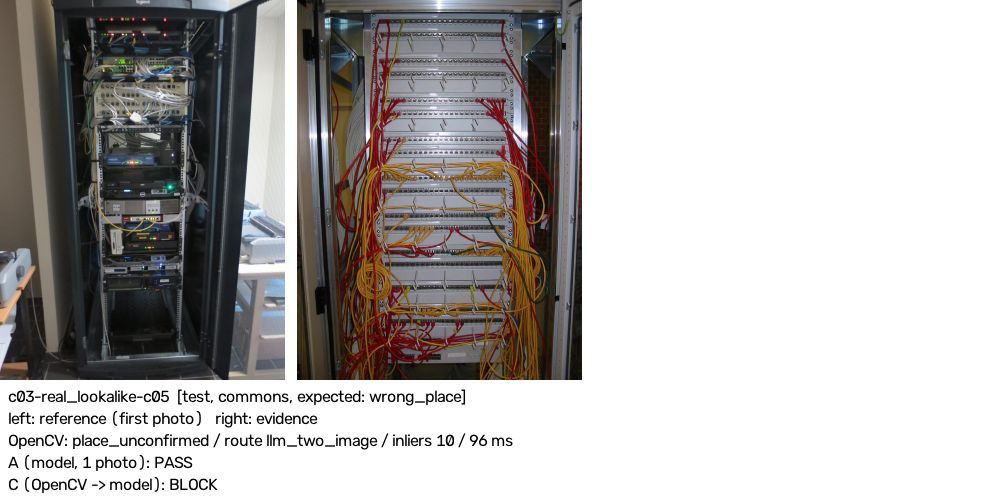

- OpenCV: `{'decision': 'place_unconfirmed', 'reason_code': 'place_unconfirmed', 'route': 'llm_two_image', 'inliers': 10, 'scene_status': 'not_matched', 'change': None, 'ms_total': 96.37}`
- A: model passed=True: The open network cabinet is clearly visible with multiple patch panel rows fully populated with RJ45 ports and numerous red, yellow, and green cables landed across them.
- A': model passed=False, same_place=False: The second photo shows a different network cabinet filled entirely with patch panels and coloured patch cables, but it is clearly a different cabinet and location from the first photo (different enclosure style, different contents, brick wall background vs. plain wall), so this does not confirm the correct cabinet was opened.
- C: OpenCV place_unconfirmed -> model passed=False, same_place=False: The second photo clearly shows a patch panel with cables, but it is a different cabinet in a different location (white frame, brick wall background, red/yellow patch cables) — not the same dark Legrand cabinet shown in the starting photo.
- C blocked by: model

### c03-replay_reference (bad, test, commons) — C right; A' agrees with C: False
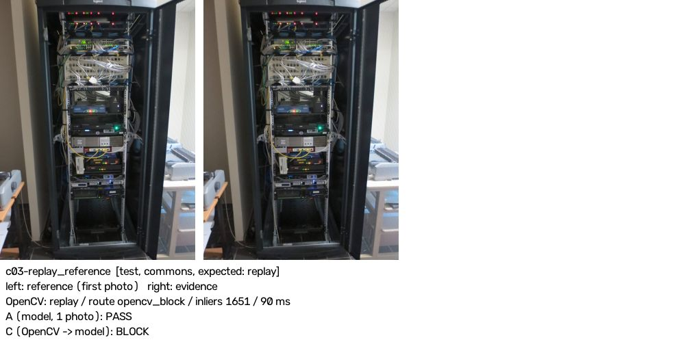

- OpenCV: `{'decision': 'replay', 'reason_code': 'replay', 'route': 'opencv_block', 'inliers': 1651, 'scene_status': 'matched', 'change': None, 'ms_total': 90.17}`
- A: model passed=True: The network cabinet is open and clearly shows patch panel units in the upper portion of the rack with multiple cables landing into their ports.
- A': model passed=True, same_place=True: The second photo shows the same open network cabinet with patch panel ports and their cables clearly visible in the upper section of the rack.
- C: OpenCV replay (replay), no model call
- C blocked by: opencv, expected reason

### c05-no_change (bad, test, commons) — C right; A' agrees with C: False
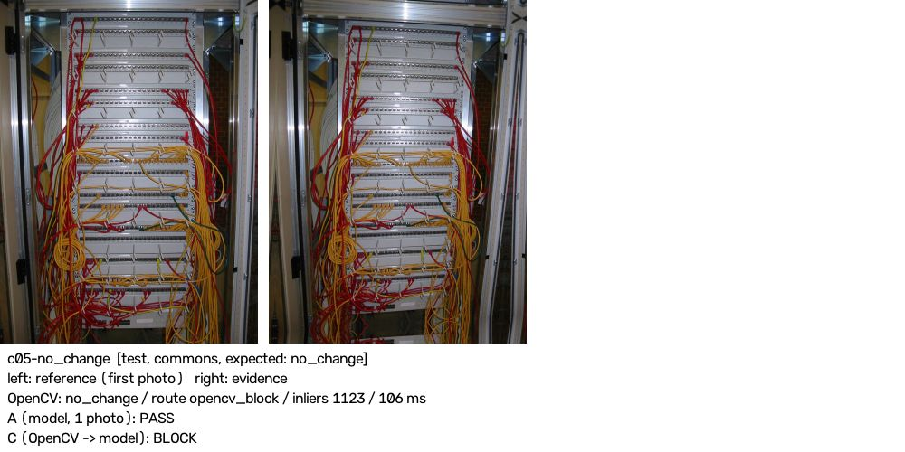

- OpenCV: `{'decision': 'no_change', 'reason_code': 'no_change_in_zone', 'route': 'opencv_block', 'inliers': 1123, 'scene_status': 'matched', 'change': 'measured', 'ms_total': 106.09}`
- A: model passed=True: The open network cabinet is clearly visible with multiple patch panel rows and their red, yellow, and green cables all in plain view.
- A': model passed=True, same_place=True: The second photo clearly shows the same open network cabinet with multiple patch panel rows and their cables (red, yellow, green) fully visible.
- C: OpenCV no_change (no_change_in_zone), no model call
- C blocked by: opencv, expected reason

### c05-overexposed (bad, test, commons) — C right; A' agrees with C: False
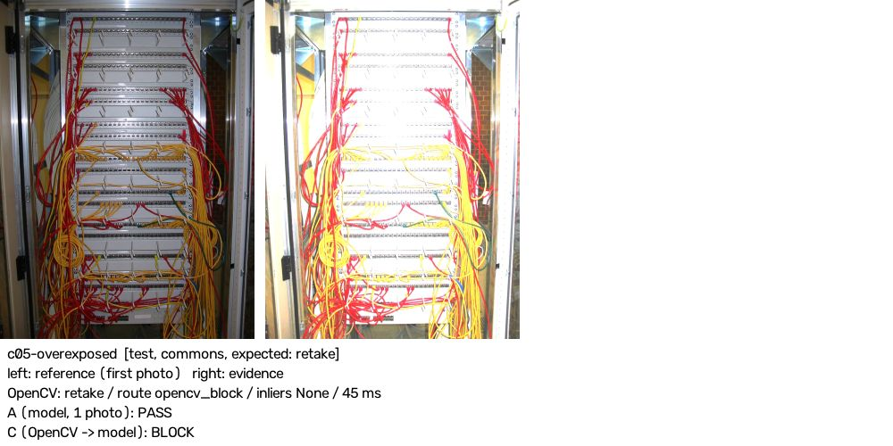

- OpenCV: `{'decision': 'retake', 'reason_code': 'overexposed', 'route': 'opencv_block', 'inliers': None, 'scene_status': None, 'change': None, 'ms_total': 45.14}`
- A: model passed=True: The open network cabinet is clearly visible with multiple patch panel rows and their associated red and yellow cables landing on the ports.
- A': model passed=True, same_place=True: The second photo clearly shows the same open network cabinet with multiple patch panel rows and their coloured cables visible, confirming the patch panel has been found.
- C: OpenCV retake (overexposed), no model call
- C blocked by: opencv, expected reason

### c05-real_lookalike-c03 (bad, test, commons) — C right; A' agrees with C: True
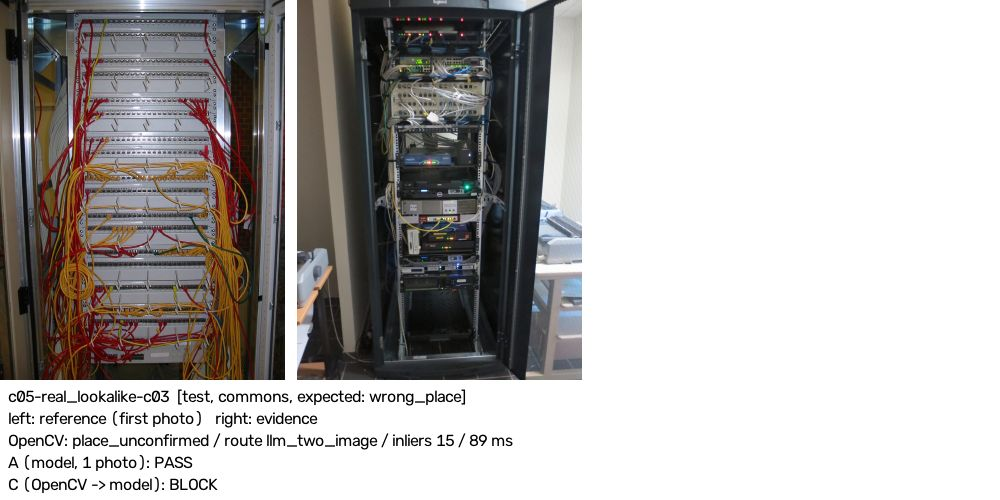

- OpenCV: `{'decision': 'place_unconfirmed', 'reason_code': 'place_unconfirmed', 'route': 'llm_two_image', 'inliers': 15, 'scene_status': 'not_matched', 'change': None, 'ms_total': 88.82}`
- A: model passed=True: The network cabinet is open and clearly shows patch panel units with multiple ports and cables landing on them in the upper section of the rack.
- A': model passed=False, same_place=False: The second photo shows a different network cabinet (dark/black rack with servers and active equipment) — not the same white open-door patch panel cabinet from the first photo, so this is a different location and the correct patch panel is not confirmed.
- C: OpenCV place_unconfirmed -> model passed=False, same_place=False: The second photo shows a different network cabinet (dark rack with servers and switches) — not the same white open-frame patch panel cabinet from the starting photo, so this is a different place and the patch panel ports and their cables are not clearly visible.
- C blocked by: model

### c08-zone_cut (bad, test, commons) — C right; A' agrees with C: False
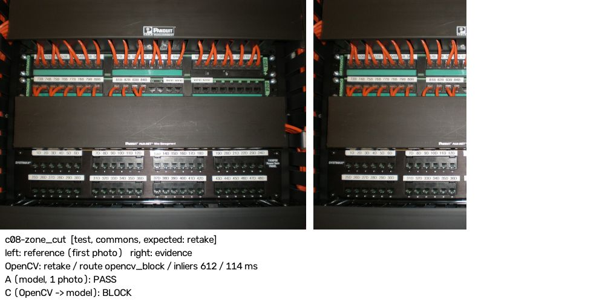

- OpenCV: `{'decision': 'retake', 'reason_code': 'zone_out_of_frame', 'route': 'opencv_block', 'inliers': 612, 'scene_status': 'matched', 'change': None, 'ms_total': 114.42}`
- A: model passed=True: The open network cabinet is clearly visible with multiple patch panels (Ortronics and Systimax brands) showing labeled ports and orange patch cables landed in them.
- A': model passed=True, same_place=True: The second photo clearly shows the same network cabinet with the same patch panels (Ortronics/Panduit rows with orange cables and the Systimax 1100PSE panel below), confirming the patch panel and its landed cables are visible.
- C: OpenCV retake (zone_out_of_frame), no model call
- C blocked by: opencv, expected reason

### c09-glare (bad, test, commons) — C right; A' agrees with C: True
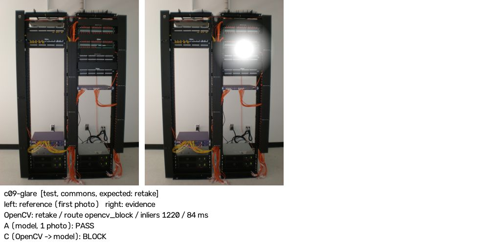

- OpenCV: `{'decision': 'retake', 'reason_code': 'glare_on_zone', 'route': 'opencv_block', 'inliers': 1220, 'scene_status': 'matched', 'change': None, 'ms_total': 83.54}`
- A: model passed=True: The open network cabinet is clearly visible with multiple patch panels populated with ports and cables (orange fiber and yellow/other patch cables) landing on them.
- A': model passed=False, same_place=True: The second photo is the same cabinet but a large bright glare (flash reflection) obscures several of the patch panel rows in the upper-right section, making the ports and their cables in that area not clearly visible.
- C: OpenCV retake (glare_on_zone), no model call
- C blocked by: opencv, expected reason

### c09-overexposed (bad, test, commons) — C right; A' agrees with C: False
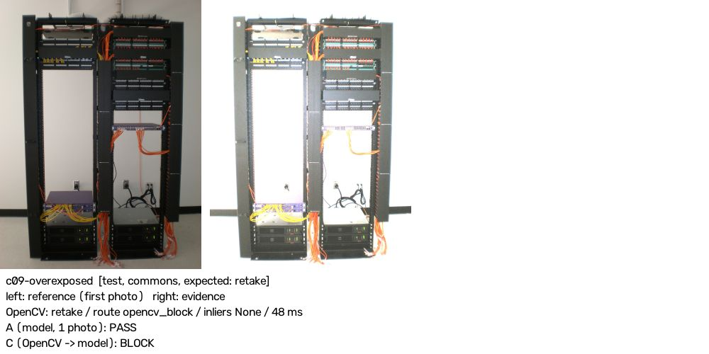

- OpenCV: `{'decision': 'retake', 'reason_code': 'overexposed', 'route': 'opencv_block', 'inliers': None, 'scene_status': None, 'change': None, 'ms_total': 48.35}`
- A: model passed=True: The open network cabinet is clearly visible with multiple patch panels populated with cables (orange, yellow, and black) in both rack sections.
- A': model passed=True, same_place=True: The second photo clearly shows the same open network cabinet with multiple patch panels and their cables visibly landed on the ports.
- C: OpenCV retake (overexposed), no model call
- C blocked by: opencv, expected reason

### c09-real_same_place-c10 (good, test, commons) — C WRONG; A' agrees with C: True
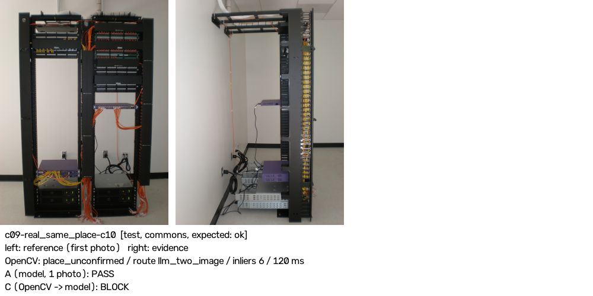

- OpenCV: `{'decision': 'place_unconfirmed', 'reason_code': 'place_unconfirmed', 'route': 'llm_two_image', 'inliers': 6, 'scene_status': 'not_matched', 'change': None, 'ms_total': 120.35}`
- A: model passed=True: The open network rack is clearly visible with multiple patch panel units on the right side showing rows of populated ports with yellow cables landed into them.
- A': model passed=False, same_place=True: The second photo shows the same cabinet from the side/rear angle, so the patch panel port faces and their landed cables are not visible — only the cable management spine is shown.
- C: OpenCV place_unconfirmed -> model passed=False, same_place=True: The second photo shows the cabinet from the side/rear angle — the patch panel port faces and their landed cables are not visible from this view.
- C blocked by: model

### c09-touched_avoid (bad, test, commons) — C right; A' agrees with C: False
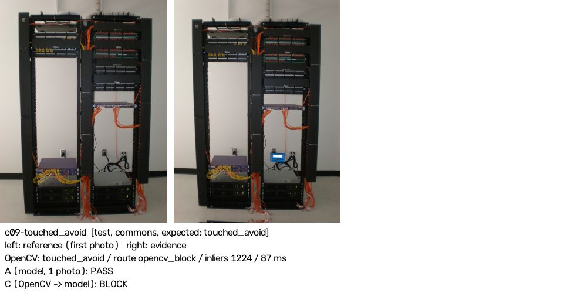

- OpenCV: `{'decision': 'touched_avoid', 'reason_code': 'change_in_avoid', 'route': 'opencv_block', 'inliers': 1224, 'scene_status': 'matched', 'change': 'measured', 'ms_total': 87.32}`
- A: model passed=True: The open network rack is clearly visible with multiple patch panels populated with cables on both the left and right sections.
- A': model passed=True, same_place=True: The second photo clearly shows the same open network cabinet with multiple patch panels and their cables visible across the upper portion of both rack sections.
- C: OpenCV touched_avoid (change_in_avoid), no model call
- C blocked by: opencv, expected reason

### c10-touched_avoid (bad, test, commons) — C right; A' agrees with C: False
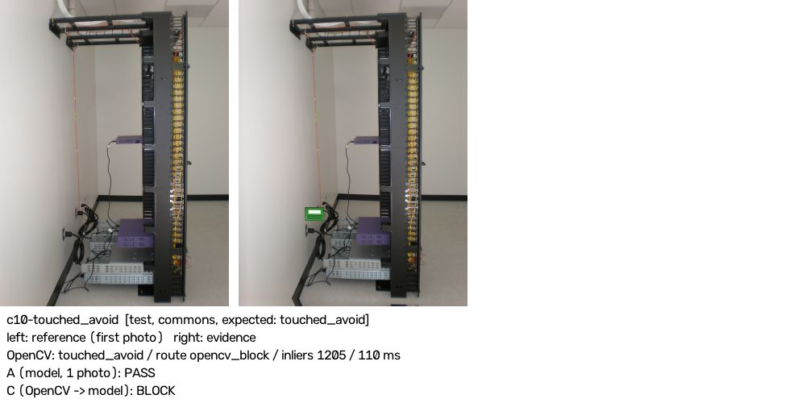

- OpenCV: `{'decision': 'touched_avoid', 'reason_code': 'change_in_avoid', 'route': 'opencv_block', 'inliers': 1205, 'scene_status': 'matched', 'change': 'measured', 'ms_total': 110.27}`
- A: model passed=True: The open network rack is clearly visible with multiple patch panel modules populated with yellow cables along the right-hand cable management side, confirming the patch panel and its room cable terminations are accessible.
- A': model passed=True, same_place=True: The second photo clearly shows the same open network rack with the patch panel ports and their yellow cables visible along the right-hand vertical cable manager, confirming the patch panel has been located.
- C: OpenCV touched_avoid (change_in_avoid), no model call
- C blocked by: opencv, expected reason

### c21-blur_gaussian (bad, test, commons) — C right; A' agrees with C: False
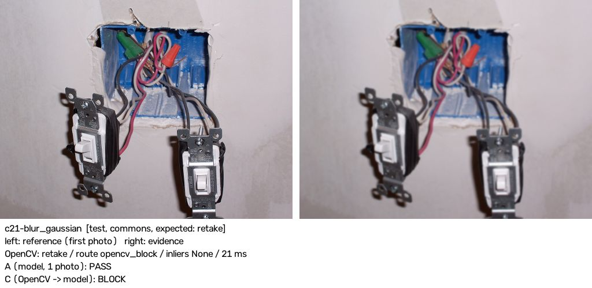

- OpenCV: `{'decision': 'retake', 'reason_code': 'blurry', 'route': 'opencv_block', 'inliers': None, 'scene_status': None, 'change': None, 'ms_total': 21.16}`
- A: model passed=True: The junction box is open and clearly shows multiple wires (black, white, red, and a green wire nut, plus orange wire nuts) visible inside the open box cavity in the wall.
- A': model passed=True, same_place=True: The second photo shows the same open junction box with the wires (green wire nut, red wire nut, pink/white/grey cables) clearly visible inside, confirming the cover is off and the interior is accessible.
- C: OpenCV retake (blurry), no model call
- C blocked by: opencv, expected reason

### c22-real_lookalike-c31 (bad, test, commons) — C right; A' agrees with C: True
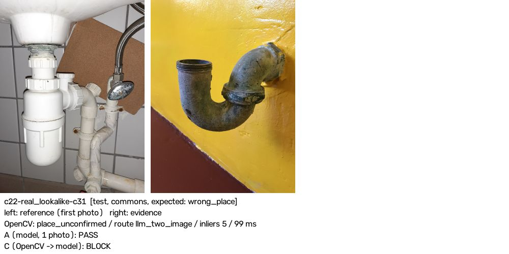

- OpenCV: `{'decision': 'place_unconfirmed', 'reason_code': 'place_unconfirmed', 'route': 'llm_two_image', 'inliers': 5, 'scene_status': 'not_matched', 'change': None, 'ms_total': 98.72}`
- A: model passed=True: The drain trap (P-trap) is clearly visible and in sharp focus, with its slip-nut joint clearly shown at the centre of the frame.
- A': model passed=False, same_place=False: The second photo shows a corroded metal P-trap mounted on a yellow-painted wall — a completely different location and fixture from the white plastic bottle-trap under the tiled sink in the first photo.
- C: OpenCV place_unconfirmed -> model passed=False, same_place=False: The second photo shows a corroded metal P-trap mounted on a yellow-painted wall — a completely different location and fitting from the white plastic bottle-trap under the tiled sink in the first photo.
- C blocked by: model

### c22-replay_exact (bad, test, commons) — C right; A' agrees with C: True
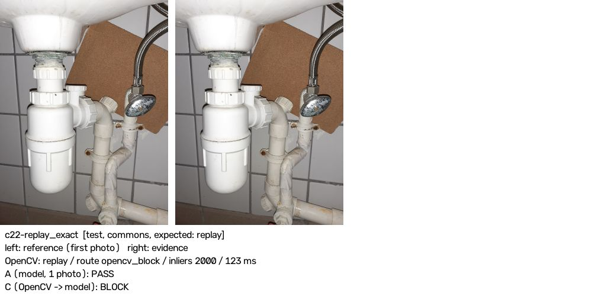

- OpenCV: `{'decision': 'replay', 'reason_code': 'replay', 'route': 'opencv_block', 'inliers': 2000, 'scene_status': 'matched', 'change': None, 'ms_total': 122.96}`
- A: model passed=True: The sink trap (bottle trap) and its slip-nut joints are clearly visible and in focus under the sink.
- A': model passed=False, same_place=True: The second photo appears to be identical to the first — no wiping has been done and there is no evidence the trap was dried and inspected; the two images look like the same unmodified shot.
- C: OpenCV replay (replay), no model call
- C blocked by: opencv, expected reason

### c23-no_change (bad, test, commons) — C right; A' agrees with C: False
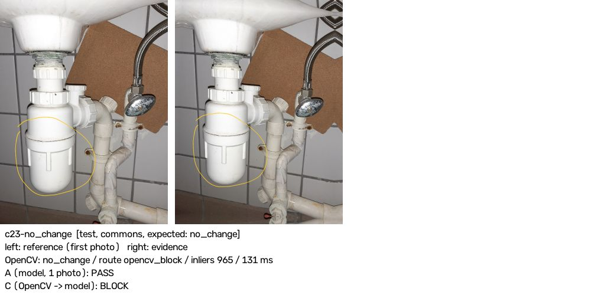

- OpenCV: `{'decision': 'no_change', 'reason_code': 'no_change_in_zone', 'route': 'opencv_block', 'inliers': 965, 'scene_status': 'matched', 'change': 'measured', 'ms_total': 131.15}`
- A: model passed=True: The drain trap and its slip-nut joints are clearly visible and in focus under the sink, with the trap body and connection joints well lit and dry-looking.
- A': model passed=True, same_place=True: The second photo clearly shows the same sink trap and its slip-nut joints in focus, dry and visible, from the same location as the first photo.
- C: OpenCV no_change (no_change_in_zone), no model call
- C blocked by: opencv, expected reason

### c24-replay_reference (bad, test, commons) — C right; A' agrees with C: True
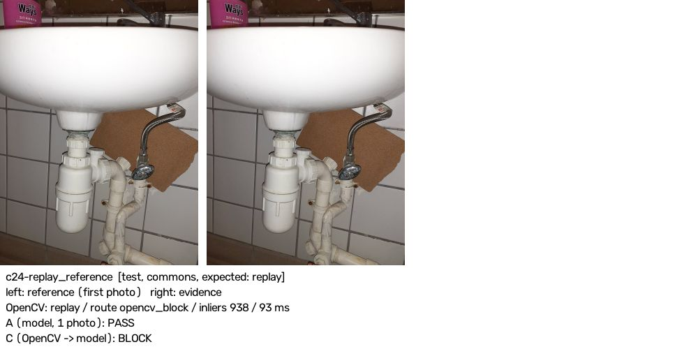

- OpenCV: `{'decision': 'replay', 'reason_code': 'replay', 'route': 'opencv_block', 'inliers': 938, 'scene_status': 'matched', 'change': None, 'ms_total': 92.83}`
- A: model passed=True: The drain trap (bottle trap) under the sink is clearly visible and in focus, with its slip-nut joints shown at the top inlet and around the trap body.
- A': model passed=False, same_place=True: The second photo is virtually identical to the first — the trap and its slip-nut joints are visible but there is no evidence the trap was wiped dry or inspected; the photo appears to be a duplicate of the starting image rather than a new close-up showing dry, examined joints.
- C: OpenCV replay (replay), no model call
- C blocked by: opencv, expected reason

### c27-replay_exact (bad, test, commons) — C right; A' agrees with C: False
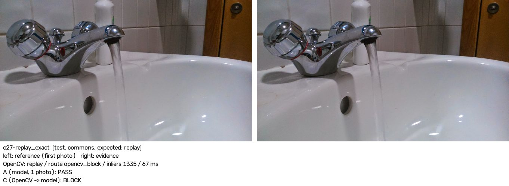

- OpenCV: `{'decision': 'replay', 'reason_code': 'replay', 'route': 'opencv_block', 'inliers': 1335, 'scene_status': 'matched', 'change': None, 'ms_total': 67.03}`
- A: model passed=True: Water is clearly running from the tap into the basin.
- A': model passed=True, same_place=True: Water is clearly running from the tap into the basin in the evidence photo.
- C: OpenCV replay (replay), no model call
- C blocked by: opencv, expected reason

### c30-replay_earlier (bad, test, commons) — C right; A' agrees with C: True
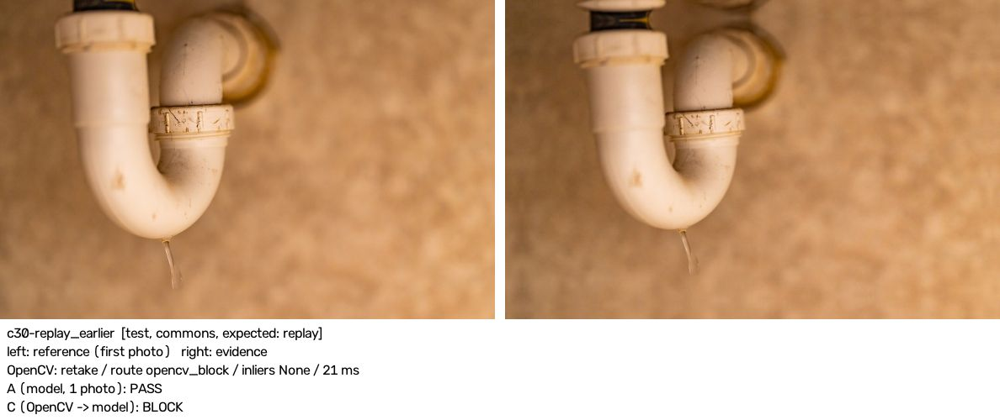

- OpenCV: `{'decision': 'retake', 'reason_code': 'blurry', 'route': 'opencv_block', 'inliers': None, 'scene_status': None, 'change': None, 'ms_total': 21.02}`
- A: model passed=True: The P-trap and its slip-nut joints are clearly visible and in focus, and a water drop is actively forming at the bottom of the trap, confirming the leak check was performed.
- A': model passed=False, same_place=True: The trap joints are visible but the trap has not been wiped dry — an active water drip is still hanging from the bottom of the trap, so no dry inspection could have taken place.
- C: OpenCV retake (blurry), no model call
- C blocked by: opencv, other reason (blurry)

### c31-real_lookalike-c24 (bad, test, commons) — C right; A' agrees with C: True
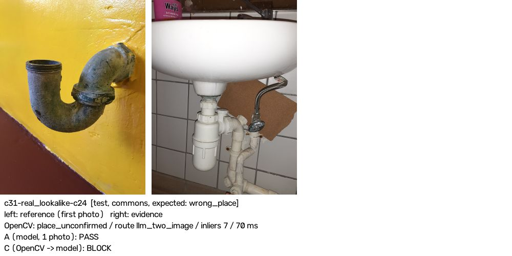

- OpenCV: `{'decision': 'place_unconfirmed', 'reason_code': 'place_unconfirmed', 'route': 'llm_two_image', 'inliers': 7, 'scene_status': 'not_matched', 'change': None, 'ms_total': 70.19}`
- A: model passed=True: The drain trap (bottle trap) under the sink is clearly visible and in focus, with its slip-nut joints at the top and sides well shown.
- A': model passed=False, same_place=False: The second photo shows a completely different sink trap (white plastic bottle-trap under a ceramic basin with white tiles) — not the same corroded brass P-trap on a yellow wall shown in the first photo.
- C: OpenCV place_unconfirmed -> model passed=False, same_place=False: The second photo shows a different sink and trap entirely — a white plastic bottle-trap under a white ceramic basin, while the starting photo shows an old metal P-trap against a yellow wall; these are not the same place.
- C blocked by: model

### c39-replay_earlier (bad, test, commons) — C right; A' agrees with C: False
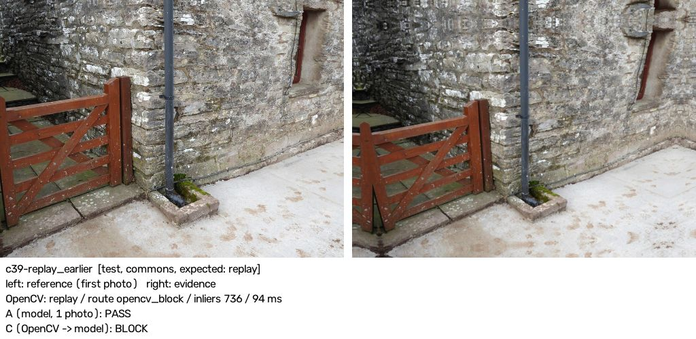

- OpenCV: `{'decision': 'replay', 'reason_code': 'replay', 'route': 'opencv_block', 'inliers': 736, 'scene_status': 'matched', 'change': None, 'ms_total': 94.48}`
- A: model passed=True: The downspout and its outlet at the bottom are clearly visible, terminating into a stone drain basin at ground level.
- A': model passed=True, same_place=True: The second photo clearly shows the same downspout at the same location, with its outlet and the stone catch basin at the bottom clearly visible.
- C: OpenCV replay (replay), no model call
- C blocked by: opencv, expected reason

